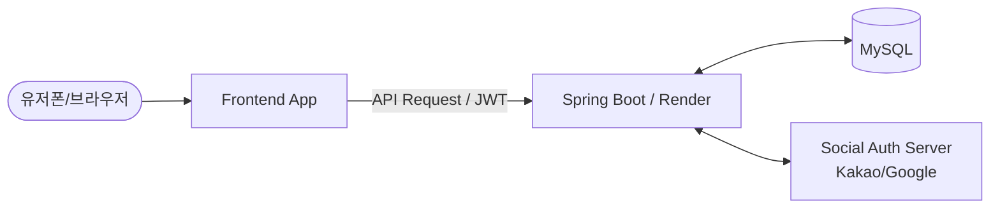

# 🏆 Me-Li-Cl: Media Life Class (미라클)
> **"도파민 중독의 미디어 라이프를 클린하게, 오늘부터 시작되는 기적 같은 기록 갓생"**

 

## 🌿 1. 기획 의도
현대인들은 유튜브 쇼츠, 인스타그램 릴스 등 무분별한 미디어 콘텐츠와 도파민 중독으로 인해 일상의 균형을 잃어가고 있습니다.
**[Media Life Class(미라클)]**은 무의미하게 소비되는 미디어 시간은 줄이고(`Clean`), 그 자리에 공부와 운동을 채워 일상의 기적(`Miracle`) 같은 균형을 잡도록 돕는 웹 서비스입니다.

* **기록을 통한 인지:** 오늘 하루 스마트폰/컴퓨터 등의 미디어 사용 시간과 공부·운동을 무엇을 얼마나 했는지 직관적으로 기록합니다.
* **대시보드 시각화:** 나의 하루 시간 균형을 차트로 한눈에 파악하고 피드백을 얻습니다.
* **갓생 시너지 공유:** 소셜 로그인으로 빠르게 가입하고, 다른 유저들과 오늘의 '미라밸(미디어-라이프 밸런스)'을 피드로 공유하며 함께 성장합니다.

 

## 🛠️ 2. 프로젝트 사양 & 기술 스택

### 💻 개발 환경
* **Frontend:** React.js, Tailwind CSS, Axios, Chart.js (UI 생성: Bolt.new 활용)
* **Backend:** Java, Spring Boot 3.x, Spring Security, Spring Data JPA
* **Database:** MySQL
* **Deployment:** Vercel (Frontend) / Render.com (Backend)

### 📐 아키텍처 구조

 

## ✨ 3. 핵심 기능 목록 (Core Features)

### 🔑 1. 인증 및 유저 관리 (Authentication)
* **소셜 로그인 (OAuth 2.0):** 카카오/구글 API 연동을 통한 간편 회원가입 및 로그인
* **자체 인증 시스템:** 소셜 인증 완료 후 Spring Boot에서 자체 **JWT (Access Token / Refresh Token)** 발급

### 📊 2. 오늘 하루 '미디어-라이프' 기록 (Main CRUD)
* **Create:** 오늘 사용한 [미디어 시간/앱], 실행한 [공부 시간/과목], [운동 시간/종류] 기록 등록
* **Read:** 대시보드(Chart.js)를 통해 나의 일일/주간 미디어 대비 생산성 시간 비율 시각화 조회
* **Update / Delete:** 잘못 입력한 시간 및 활동 기록 수정 및 삭제

### 👥 3. 실시간 갓생 피드 공유 (Social Feed)
* **공유하기:** 버튼 클릭 한 번으로 내 오늘 대시보드와 한 줄 평을 피드에 업로드
* **커뮤니티 조회:** 다른 유저들의 미라밸 실시간 피드 조회 및 응원 기능 (좋아요 인터랙션)

 
